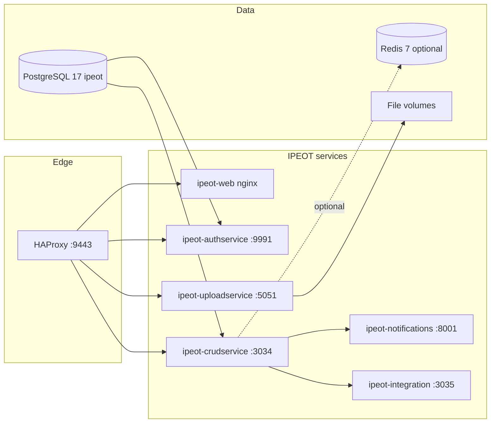

# IPEOT Unified Digital Workflow Portal — Technical Implementation Blueprint

**Source:** `BRD – IPEOT Unified Digital Workflow Portal Draft.docx` (Draft · October 2026)  
**Purpose:** Build-ready companion to the BRD — architecture, stack, modules, data model, integrations, and delivery plan.  
**Relationship to ADB360:** **Separate product** — no shared database, sessions, code, or HAProxy routes with ADB. Reuse **patterns and service layout** from ADB (authservice + crudservice + SPA + upload + compose).

---

## 1. Executive alignment

| BRD goal | Technical outcome |
|----------|-------------------|
| Single lifecycle (requisition → closure) | One SPA + workflow engine + project workspace per `project_id` |
| Configurable approvals | Admin-defined stages/matrix (no code deploy for matrix changes) |
| LIMS + ISO docs + reports | Sub-domains under same `project_id`; upload service for files |
| SAP WBS | Integration service (async jobs + manual fallback queue for PCC) |
| Knowledge + AI (Phase 2) | Object store + search index + on-prem LLM/RAG service |
| Dashboards / MIS | Read models + reporting API; export PDF/Excel |
| ONGC SSO + 2FA | authservice (LDAP/SSO adapter); optional OTP step |
| Audit / ISO | Append-only audit log; document version tables |

**Scale (NFR-04):** ~300 named users, ~100 concurrent — PostgreSQL (data + **connect-pg-simple** sessions) + stateless Node APIs; optional Redis for job queues / SLA reminders at launch.

---

## 2. Recommended repository layout (greenfield)

Mirror ADB monorepo **structure**, not ADB **code**:

```text
ipeot-portal/
├── ipeot-web/                 # React 19 + Vite 8 + TypeScript + Tailwind 4
├── ipeot-authservice/         # Express, session, LDAP/SSO, pg sessions
├── ipeot-crudservice/         # Express, generic CRUD + domain routes + workflow
├── ipeot-uploadservice/       # Multer, virus scan hook, S3/local volume
├── ipeot-notifications/       # FastAPI or Node — email/SMS/digest (like MAIL_API)
├── ipeot-integration/         # SAP WBS, org master sync (optional separate service)
├── ipeot-ai/                  # Phase 2 — RAG + report draft (on-prem only)
├── haproxy/                   # TLS termination, route /ipeot → web, /api → backends
├── migrations/                # PostgreSQL (schema ipeot)
├── docker-compose.yml
├── docker-compose.prod.yml
└── docs/
    ├── BRD – IPEOT Unified Digital Workflow Portal Draft.docx
    └── IPEOT_Portal_Technical_Implementation_Blueprint.md  (this file)
```

**Network:** Dedicated Docker network `ipeot_net`; DB `ipeot` on PostgreSQL (separate instance or separate database from `adb`).

**URLs (example):** `https://ipeot.ongc.local/` (SPA), `https://ipeot.ongc.local/api/auth`, `/api/crud`, `/api/files`.

---

## 3. Technology stack (latest baseline — Oct 2026)

Same **service class** as ADB360 (SPA + authservice + crudservice + upload + compose), but **current major versions** — do not copy ADB’s pinned older deps.

**Version policy:** Pin exact versions in each service’s `package-lock.json` / `uv.lock` at repo init; upgrade on a scheduled cadence (quarterly) after CI + VAPT smoke. Table below = target at greenfield kickoff (verified from npm/PyPI registry).

| Layer | Choice | Target version | Notes |
|-------|--------|----------------|--------|
| **Runtime** | Node.js | **22.x LTS** (`node:22-alpine` in Docker) | All Node microservices; use `engines.node >=22` |
| **Frontend** | React | **19.3.x** | SPA (`ipeot-web`) |
| | Vite | **8.3.x** | Build + dev server |
| | TypeScript | **7.0.x** | Align with Vite 8 + `@types/react` 19; pin in lockfile |
| | TanStack Query | **5.105.x** | Server state / caching |
| | React Router | **7.18.x** | Client routing |
| **UI** | Tailwind CSS | **4.3.x** | Use `@tailwindcss/vite` plugin (Tailwind v4 pipeline) |
| **HTTP (Node)** | Express | **5.3.x** | authservice, crudservice, uploadservice, integration |
| | express-session | **1.19.x** | Session cookie |
| | connect-pg-simple | **10.0.x** | PostgreSQL session store |
| | pg (node-postgres) | **8.23.x** | DB driver |
| | multer | **2.5.x** | Multipart uploads |
| **Database** | PostgreSQL | **17.x** (Docker `postgres:17-alpine`) | Schema `ipeot`; separate DB/instance from ADB |
| **Cache / queues** | Redis | **7.4.x** (optional at launch) | SLA reminders, job queue; client `redis` **6.3.x** |
| **Files** | ipeot-uploadservice | Node 22 + Express 5 + volume | Virus-scan hook (ClamAV sidecar optional) |
| **Edge** | HAProxy | **3.2 LTS** or `haproxy:lts` | TLS 1.2+; separate vhost from ADB |
| **Static** | nginx | **1.27-alpine** (stage 2 of web image) | Serves Vite build output |
| **Notifications** | Python | **3.13-slim** (Docker) | Recommended over 3.11 for greenfield |
| | FastAPI | **0.162.x** | Email, SMS, digests (optional service) |
| | Uvicorn | **0.54.x** | ASGI server |
| | Pydantic | **2.14.x** | Settings / validation |
| **PDF / reports** | Node service | Puppeteer **latest** + `docx` / PDF lib | Locked final report; isolate in worker container |
| **Search (Phase 2)** | PostgreSQL FTS or OpenSearch | **2.x** if OpenSearch | Full-text on reports metadata |
| **AI (Phase 2)** | On-prem LLM + embeddings | Org-approved image | NFR-02: no data leaves ONGC network |
| **CI / test** | Vitest | **5.0.x** | Frontend unit tests |
| | node:test | Built-in Node 22 | Backend unit/integration tests |

### 3.1 Docker base images (reference)

```dockerfile
# Node services (auth, crud, upload, integration)
FROM node:22-alpine

# ipeot-web build stage
FROM node:22-alpine AS build
# ipeot-web runtime
FROM nginx:1.27-alpine

# PostgreSQL
FROM postgres:17-alpine

# ipeot-notifications
FROM python:3.13-slim
```

### 3.2 ADB vs IPEOT stack (intentional drift)

| Component | ADB360 (legacy in repo) | IPEOT (this project) |
|-----------|-------------------------|----------------------|
| Node | 20.x | **22.x LTS** |
| React | 18.3 | **19.3** |
| Vite | 5.4 | **8.3** |
| Tailwind | 3.4 | **4.3** |
| Express | 4.18 (most services) | **5.3** (all Node HTTP) |
| PostgreSQL | 15+ / external | **17** |
| FastAPI | 0.104 / Py 3.11 | **0.162 / Py 3.13** |

**Registry snapshot (kickoff pin examples):** React 19.3.1 · Vite 8.3.5 · TypeScript 7.0.2 · Tailwind 4.3.3 · Express 5.3.0 · pg 8.23.1 · connect-pg-simple 10.0.0 · Vitest 5.0.5 · FastAPI 0.162.0 · Uvicorn 0.54.0 · Pydantic 2.14.1.

**Explicitly not used:** ADB `adb` schema, ADB rbac_assignments, ADB proposal/MoM modules, ADB session cookies.

---

## 4. Container topology (docker-compose)



| Service | Responsibility | Health |
|---------|----------------|--------|
| **ipeot-web** | Static SPA | `GET /` |
| **ipeot-authservice** | Login, SSO, session, 2FA gate | `GET /ping` |
| **ipeot-crudservice** | All business APIs, workflow transitions | `GET /ping` |
| **ipeot-uploadservice** | Upload/download; links `file_id` in DB | `GET /health` |
| **ipeot-notifications** | Email, SMS escalation, daily digest | `GET /health` |
| **ipeot-integration** | SAP WBS create/close, org sync jobs | `GET /health` |
| **ipeot-ai** (Ph2) | Draft report, chatbot | Internal only |

**Environment:** Per-service `.env` + shared `ipeot-crudservice/env` for `DEV_DB_*`, `SESSION_SECRET` (must match authservice).

---

## 5. Module map — BRD functional requirements → services

| FR # | BRD requirement | Primary module | Service / schema area |
|------|-----------------|----------------|------------------------|
| 1 | User authentication (SSO, 2FA) | Auth | authservice + `ipeot.users` / session |
| 2 | RBAC + user admin + delegation | Admin | crudservice `/admin/*`, `ipeot.roles`, `assignments` |
| 3 | Master data + configurable workflow | Admin + Workflow engine | `departments`, `project_types`, `approval_matrix`, `sla_rules` |
| 4 | AWP cycle management | AWP | `awp_cycles`, `awp_submissions` |
| 5–6 | Proposal submission (3 categories) | Proposals | `projects`, `proposals`, versioning |
| 7–8 | I/C review, HOD endorsement | Workflow | state machine + tasks |
| 9 | Final authorization (HOI/TAC/Dir) | Workflow + TAC | `tac_agenda`, `tac_decisions` |
| 10 | Timeline / escalation | Scheduler | cron in crudservice or worker + `sla_events` |
| 11 | SAP WBS auto | Integration | `sap_wbs_jobs`, fallback PCC queue |
| 12–13 | CI workspace + dashboard | Project workspace | `project_members`, milestones |
| 14 | ISO PDS/PAS/PCR | Documents | `iso_documents`, versions |
| 15 | LIMS | LIMS | `samples`, `tests`, `results`, `instruments` |
| 16 | AI report assistant | AI (Ph2 in BRD §2.6; FR High) | ipeot-ai |
| 17 | Report approval | Workflow + PDF lock | `reports`, signatures |
| 18 | Closure + publishing | Closure | accession, distribution lists, website export |
| 19 | Dashboards MIS | Analytics | materialized views / reporting endpoints |
| 20–21 | Knowledge repo + chatbot | Search + AI (Ph2) | `knowledge_documents`, index |
| 22 | Notifications | notifications | templates + outbox |
| 23 | Audit trail | Cross-cutting | `audit_log` (append-only) |
| 24 | Document upload | uploadservice | `files` metadata in PG |
| 25 | External integrations | integration | SAP, SSO, email, website API |
| 26 | Phase 2 extras | Ph2 modules | timesheets, newsletters, external standards DB |

**BRD phase note:** §2.6 puts **LIMS, workflow, SAP, dashboards in Phase 1**; **AI report assistant, chatbot, legacy report migration in Phase 2**. Implementation plan below follows §2.6 (not the FR priority column alone).

---

## 6. Core domain model (PostgreSQL schema sketch)

All tables in schema **`ipeot`**. Use `bigint` PKs, `timestamptz`, soft-delete only where BRD allows.

### 6.1 Organisation & security

- `departments` — 7 IPEOT departments (+ codes)
- `work_centres`, `installations`
- `users` — CPF, name, email, phone, active; sync fields from SAP/AD
- `roles`, `permissions`, `user_role_assignments` — scope: global / department / work_centre
- `role_delegations` — acting officer during leave
- `approval_matrix` — JSON or normalized: `(project_category, department_id) → ordered stages[]`
- `sla_rules` — stage → target days, reminder offsets, escalation role

### 6.2 Project lifecycle

- `awp_cycles` — year, window open/close, status
- `projects` — `project_category` ENUM(scheduled, unscheduled, short_term), department_id, work_centre_id, status, WBS, accession_number
- `proposals` — FK project; form JSON + normalized columns; `proposal_number` unique
- `proposal_versions` — full snapshot on resubmit after scope modification
- `workflow_instances` — current_stage, started_at
- `workflow_tasks` — assignee role/user, status, remarks, due_at, completed_at
- `tac_meetings`, `tac_agenda_items`, `tac_decisions`
- `project_team` — CI, co-investigators, HOD-allotted
- `milestones` — PAS-linked progress

### 6.3 ISO documents

- `iso_documents` — type ENUM(PDS, PAS, PCR), project_id, status
- `iso_document_versions` — content JSON or file_id, approved_by, version_no

### 6.4 LIMS

- `lab_locations`, `test_methods`, `instruments`, `calibrations`
- `samples` — sample_id, barcode, project_id, received_at, custody chain
- `test_requests`, `test_results` — analyst, instrument file_id, approval state
- `consumables`, `maintenance_tickets`

### 6.5 Reports & closure

- `report_drafts` — sections, AI-generated flags (Ph2)
- `report_versions`, `report_approvals`
- `final_reports` — locked PDF file_id, digital signature metadata
- `distribution_log` — L-1/L-2/L-3, coordinator
- `work_centre_feedback`

### 6.6 Platform

- `files` — storage key, mime, size, virus_scan_status, uploaded_by
- `notifications`, `notification_preferences`
- `audit_log` — entity, action, actor, payload JSON, immutable
- `sap_wbs_jobs` — request/response, retry, manual_pcc_flag
- `integration_outbox` — email/website publish jobs

---

## 7. Workflow engine (configurable matrix)

**Design:** Data-driven state machine (not hard-coded per stage).

1. On proposal submit → load `approval_matrix` for `(category, department)`.
2. Create `workflow_instance` + first `workflow_task` (e.g. I/C).
3. Transition API: `POST /workflow/tasks/:id/complete` with `{ action: accept|modify|reject|endorse|authorize, remarks }`.
4. **Modify scope** → clone proposal to new version, reset to L-3 task.
5. **Reject** → notify L-3, L-2, coordinator (FR-7).
6. **Short-term path** → skip HOI on report approval per Annexure 2.
7. Every transition → `audit_log` + optional notification.

**Admin (FR-3):** CRUD on matrix rows; validate no cycles; log config changes.

Reference hierarchy (from BRD Annexure 2):

| Stage | Scheduled / Unscheduled | Short-term |
|-------|-------------------------|------------|
| Proposal | AWP / L-3 → coordinator → PCC | Same |
| Technical review | I/C | I/C |
| Endorsement | HOD + CI allotment | HOD |
| Authorization | HOI → TAC → Director (Production) | HOD only |
| Report approval | I/C → HOD → HOI | I/C → HOD |

---

## 8. API surface (ipeot-crudservice)

Prefix: `/api/v1`. Session cookie from authservice (same-site).

| Area | Examples |
|------|----------|
| Proposals | `POST /proposals`, `GET /proposals/:id`, `POST /proposals/:id/submit` |
| Workflow | `GET /tasks/mine`, `POST /tasks/:id/complete` |
| Projects | `GET /projects/:id/workspace`, `PATCH /projects/:id/milestones` |
| AWP | `POST /awp/cycles`, `GET /awp/cycles/:id/submissions` |
| ISO | `GET/PUT /projects/:id/iso/:type` |
| LIMS | `POST /projects/:id/samples`, `POST /samples/:id/results` |
| Reports | `POST /projects/:id/reports/draft`, `POST /reports/:id/submit-for-approval` |
| Closure | `POST /projects/:id/close` |
| Admin | `/admin/users`, `/admin/matrix`, `/admin/project-types` |
| Dashboards | `GET /dashboards/hoi`, `/dashboards/ci`, `/dashboards/pcc`, query params |
| Files | Delegate to uploadservice via `file_id` |

**Authorization:** Middleware reads session → `user_id`, roles, scopes; row-level checks (e.g. work centre sees only their projects).

---

## 9. Integrations

| System | Direction | Mechanism |
|--------|-----------|-----------|
| **ONGC SSO / LDAP** | In | authservice (ldapjs pattern from ADB authservice) |
| **2FA** | In | TOTP or org OTP gateway — post-login step before session issue |
| **SAP** | Out | ipeot-integration: REST/SOAP adapter; WBS create on authorize; closure on PCR |
| **Email** | Out | notifications service; templates per workflow event |
| **SMS** | Out | escalation only (FR-22) |
| **IPEOT website** | Out | publish API or SFTP drop of final PDF + metadata |
| **SAP org master** | In | periodic job → `users`, `work_centres` |

**Failure handling (FR-11):** WBS failure → create PCC task + email; project status `authorized_pending_wbs`.

---

## 10. Frontend (ipeot-web) — major routes

| Route | Roles |
|-------|--------|
| `/login` | all |
| `/dashboard` | role-specific home (redirect) |
| `/awp` | PCC, coordinators, L-3 |
| `/proposals/new`, `/proposals/:id` | L-3, coordinator |
| `/inbox` | approvers (I/C, HOD, HOI, TAC) |
| `/projects`, `/projects/:id` | CI, team, I/C |
| `/projects/:id/lims` | lab, CI |
| `/projects/:id/report` | CI |
| `/admin/users`, `/admin/workflow`, `/admin/masters` | admin |
| `/knowledge` | Ph2 — search |
| `/help` | static + contextual |

Reuse ADB patterns: session refresh, role in session, API client with credentials, toast errors.

---

## 11. Non-functional implementation checklist

| NFR | Implementation |
|-----|----------------|
| NFR-01 TLS | HAProxy TLS 1.2+; HSTS internal |
| NFR-02 AI on-prem | ipeot-ai only on internal network; no outbound model APIs in prod |
| NFR-03 Audit 7y | Partition `audit_log` by year; archival job |
| NFR-05 Performance | DB indexes on status, assignee, due_at; paginate lists |
| NFR-08 Large files | uploadservice chunk limit config; ClamAV sidecar optional |
| NFR-11 REST | OpenAPI spec in `docs/openapi.yaml` |

---

## 12. Delivery plan (suggested)

### Phase 1 — Core portal (BRD §2.6)

| Sprint | Deliverables |
|--------|----------------|
| S0 | Repo scaffold, compose, migrations v001, auth login (dev LDAP), empty SPA |
| S1 | Master data admin, RBAC, audit_log |
| S2 | Proposal forms (3 categories), versioning, routing to I/C |
| S3 | Workflow engine + matrix admin + I/C/HOD/HOI/TAC paths |
| S4 | SAP WBS integration + CI workspace + team allotment |
| S5 | ISO templates (PDS/PAS/PCR) + file upload |
| S6 | LIMS core (sample → test → result approval) |
| S7 | Report approval chain + PDF lock + closure + accession |
| S8 | Dashboards (PCC, HOI, HOD, CI, work centre) + notifications |
| S9 | UAT, VAPT remediation, training |

### Phase 2

| Sprint | Deliverables |
|--------|----------------|
| P2-1 | Legacy report migration + knowledge index |
| P2-2 | AI report assistant + chatbot (RAG, citations, RBAC on chunks) |
| P2-3 | Timesheets, newsletters, external standards DB (licensed) |

---

## 13. Sample data & BRD artefacts in repo

Use bundled samples for UAT and field mapping:

- `Consolidate Sheet Data_For_IPEOT_Portal-D1.xlsx`, `Sample Sheet.xlsx` — import scripts for project types / departments
- `Department-* Sample Reports/` — PDF fixtures for knowledge migration (Ph2) and report template design

---

## 14. Security & governance

- **System owner:** IPEOT PCC + IT focal (named in project charter)
- **Secrets:** Vault or env injection; no secrets in git
- **VAPT:** Before go-live and after major releases (NFR-01)
- **Change control:** Matrix/template changes via admin only; all logged

---

## 15. Open decisions (resolve in kickoff)

1. Exact SSO protocol (SAML vs OIDC vs LDAP-only) and 2FA vendor  
2. SAP interface spec (PI/PO, BAPI, custom REST) and WBS template per department  
3. Single PostgreSQL cluster with DB `ipeot` vs dedicated instance  
4. LIMS: barcode printer integration scope at go-live  
5. Digital signature standard for locked PDF (DSC vs in-app sign-off record only)  
6. IPEOT website publish mechanism (API vs manual upload queue)  
7. Phase 1 inclusion of “in-house software tools” link portal (listed in §2.6 Ph1) — link-only vs embedded  

---

## 16. Next steps for development team

1. Create **`ipeot-portal`** repository (copy compose/Dockerfile **patterns** from ADB, not business logic).  
2. Apply **`migrations/001_ipeot_core.sql`** from this blueprint §6 (implement fully in first sprint).  
3. Implement **authservice** session contract compatible with **crudservice** middleware (clone ADB session shape, new cookie name e.g. `IPEOT_SESSION`).  
4. Build **proposal wizard** from FR-5 fields; validate against `Consolidate Sheet` columns.  
5. Implement **workflow engine** before LIMS (dependency for sample→project link).  
6. Publish **OpenAPI** and **ER diagram** as living docs alongside this blueprint.

---

*Document version: 1.1 · Derived from IPEOT BRD Draft Oct 2026 · Architecture pattern: ADB360 microservices · Stack: latest LTS/current majors (Node 22, React 19, Vite 8, Tailwind 4, Express 5, PostgreSQL 17, connect-pg-simple 10, FastAPI 0.162).*
